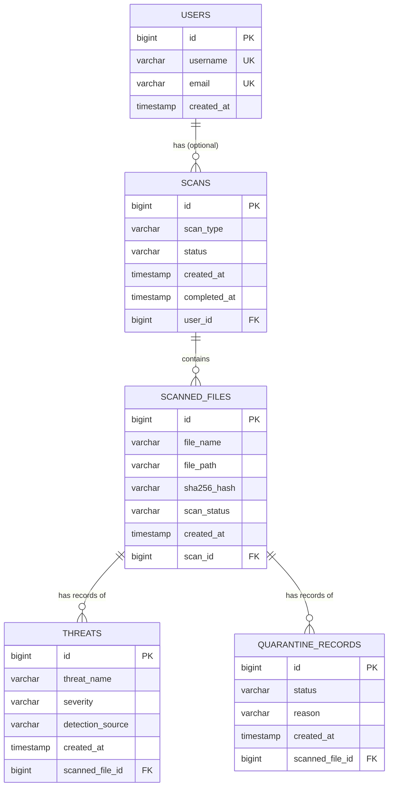

# SecureScan - Antivirus Management System Backend

A layered **Spring Boot 3 / Java 21 / PostgreSQL** REST backend that manages **scan records, scanned-file metadata,
threat records and quarantine records**.

> ## IMPORTANT - what this project is NOT
> SecureScan stores and manages **records**. It does **not** scan your computer, does **not** detect real malware,
> does **not** monitor installations, and does **not** isolate, move or delete real files.
> * Creating a scan stores a record with status `PENDING`. Nothing is scanned and no result is invented.
> * Threat records exist only if a client explicitly submits them (for example from Postman).
> * A *quarantine record* is only a database row. No file on disk is touched.
> * File paths and SHA-256 hashes are stored as text. Files are never opened, read or executed.
>
> A real antivirus engine is outside the scope of this project.

---

## 1. Verification status (read this first)

This project was generated in a sandbox that had a Java runtime but **no Maven, no internet access, no Java compiler
and no PostgreSQL**. Therefore:

| Item | Status |
|---|---|
| Source code, tests, README, Postman collection | Written |
| `mvn clean package` / executable JAR | **NOT built, NOT verified** - you must build it (Section 5) |
| Source compiled | **NOT compiled** in the sandbox |
| Unit / web-layer tests | Written, **NOT run** |
| Swagger UI / `/v3/api-docs` | Configured, **NOT opened** |
| Postman collection | Generated, **NOT executed** |
| PostgreSQL connection | **NOT tested** |

If something fails on your machine (for example a compile error), please send me the exact error text and I will fix it.
The commands in Section 5 produce the JAR; only after they succeed on your machine is the JAR "working".

---

## 2. Technology stack

Java 21, Spring Boot 3.3.5 (Spring Web, Spring Data JPA/Hibernate, Validation), PostgreSQL, Maven,
Springdoc OpenAPI 2.6.0 (Swagger UI), SLF4J + Logback, JUnit 5, Mockito, Spring Boot Test.
No Lombok, Docker, JWT or frontend.

## 3. Architecture

```
Controller  ->  Service  ->  Repository  ->  PostgreSQL
 (HTTP)        (business     (Spring Data
               rules)         JPA)
```

```
src/main/java/com/securescan
  controller/   REST endpoints (HTTP only)
  service/      business logic, transactions, status rules
  repository/   Spring Data JPA interfaces
  entity/       JPA entities (database tables)
  dto/          request/response records + ApiResponse + PageResponse
  enums/        ScanType, ScanStatus, FileScanStatus, Severity, QuarantineStatus
  exception/    custom exceptions + GlobalExceptionHandler
  config/       OpenAPI config, startup logger
src/main/resources/application.properties
src/test/java/...   JUnit 5 + Mockito service tests, @WebMvcTest controller tests
postman/SecureScan.postman_collection.json
```

DTOs are Java `record`s (compact, immutable). Entities are never returned directly from the API.

## 4. Database design (ER diagram)



Relationships in simple English:

* **User -> Scan (one-to-many, optional):** one user can have many scans. A scan may or may not belong to a user
  (`scans.user_id` can be NULL).
* **Scan -> ScannedFile (one-to-many):** one scan contains many file records; every file record must belong to a scan
  (`scan_id` NOT NULL).
* **ScannedFile -> Threat (one-to-many):** one file can have many threat records; every threat record must reference a file.
* **ScannedFile -> QuarantineRecord (one-to-many):** one file can have several quarantine records over time
  (e.g. quarantined, then released, then quarantined again). Only one *active* (`QUARANTINED`) record per file is allowed.

Design choices: all relationships are `@ManyToOne(fetch = LAZY)` from the child side only (no bidirectional links, so no
infinite JSON recursion); enums are stored as strings; foreign keys, NOT NULL, unique constraints and length limits are
declared on the entities; deleting a parent that still has children is refused with HTTP 409 (no cascade deletes).

## 5. Setup and run (Windows-friendly)

### 5.1 Install the tools
1. **JDK 21** (e.g. Eclipse Temurin 21). Check: `java -version`
2. **Apache Maven 3.9+**. Check: `mvn -version` (IntelliJ IDEA also bundles Maven if you prefer the IDE.)
3. **PostgreSQL 14+** (installer from postgresql.org). Remember the password you set for the `postgres` user.

### 5.2 Create the database
Open **SQL Shell (psql)** or a terminal:
```
psql -U postgres
CREATE DATABASE antivirus_db;
\q
```

### 5.3 Set the environment variables
The app reads `DB_URL` (optional), `DB_USERNAME` and `DB_PASSWORD`. Nothing is hardcoded.

**PowerShell (current window only):**
```powershell
$env:DB_URL = "jdbc:postgresql://localhost:5432/antivirus_db"   # optional, this is the default
$env:DB_USERNAME = "postgres"
$env:DB_PASSWORD = "your_password_here"
```
**Command Prompt (current window only):**
```
set DB_USERNAME=postgres
set DB_PASSWORD=your_password_here
```
**Permanent (new windows only - close and reopen the terminal afterwards):**
```
setx DB_USERNAME "postgres"
setx DB_PASSWORD "your_password_here"
```
Linux/macOS: `export DB_USERNAME=postgres DB_PASSWORD=your_password_here`

If `DB_USERNAME`/`DB_PASSWORD` are missing, or the database is unreachable or the password is wrong, the application
**stops at startup with an error** (for example `Could not resolve placeholder 'DB_USERNAME'` or
`password authentication failed`). It never silently ignores a bad configuration.

### 5.4 Build and test
From the project folder (the one containing `pom.xml`):
```
mvn clean package
```
This compiles, runs the tests (they need no database) and creates **`target/securescan.jar`**.
(`mvn clean package -DskipTests` skips tests.)

### 5.5 Run
```
java -jar target\securescan.jar
```
or during development: `mvn spring-boot:run`

### 5.6 Verify the database connection
At startup the log should contain lines like:
```
Database connection verified: PostgreSQL 16.x
SecureScan started. Swagger UI: http://localhost:8080/swagger-ui/index.html
```
Hibernate creates the tables automatically; check with `psql -U postgres -d antivirus_db -c "\dt"`
(expect `users`, `scans`, `scanned_files`, `threats`, `quarantine_records`).

> `spring.jpa.hibernate.ddl-auto=update` is a **development** convenience: it never drops data, but it does not handle
> renames or complex changes. For production use migrations (Flyway/Liquibase) and `validate`.

## 6. API documentation (Swagger / OpenAPI)

| What | URL |
|---|---|
| Swagger UI | http://localhost:8080/swagger-ui/index.html |
| OpenAPI JSON | http://localhost:8080/v3/api-docs |

(`/swagger-ui.html` redirects to the UI.) You can try every endpoint from Swagger UI without Postman.

## 7. Endpoints

Base path `/api`. List endpoints accept `page` (0-based), `size` (max 100) and `sort=field,asc|desc`.

| Resource | Endpoints |
|---|---|
| Users | `POST /api/users`, `GET /api/users`, `GET/PUT/DELETE /api/users/{id}` |
| Scans | `POST /api/scans`, `GET /api/scans?status=&userId=`, `GET/PUT/DELETE /api/scans/{id}`, `GET /api/scans/{id}/files` |
| Files | `POST /api/files`, `GET /api/files?scanId=`, `GET/PUT/DELETE /api/files/{id}` |
| Threats | `POST /api/threats`, `GET /api/threats?severity=&fileId=`, `GET/PUT/DELETE /api/threats/{id}` |
| Quarantine | `POST /api/quarantine`, `GET /api/quarantine?status=&fileId=`, `GET/PUT/DELETE /api/quarantine/{id}` |

### Business rules
* **Scan creation:** always `PENDING`, `completedAt = null`. The optional `userId` must exist (404 otherwise).
* **Scan status transitions** (via `PUT /api/scans/{id}`; a manual update - nothing is actually scanned):
  `PENDING -> RUNNING`, `RUNNING -> COMPLETED`, `RUNNING -> FAILED`. Everything else returns **409**.
  `completedAt` is set only when moving to `COMPLETED`. `scanType` can only change while `PENDING`.
* **Files** can be added only to scans that are not `COMPLETED`/`FAILED`. `sha256Hash` is optional: exactly 64 hex characters (stored lowercase).
  `scanStatus` is `PENDING`/`SCANNED`/`ERROR`; `SCANNED` does **not** mean "clean".
* **Quarantine records** start as `QUARANTINED`; transitions: `QUARANTINED -> RESTORED` or `QUARANTINED -> RELEASED`
  (both final). A file may have only one active `QUARANTINED` record. Database records only.
* **Deleting** a user with scans, a scan with files, or a file with threat/quarantine records returns **409**.
* A referenced id that does not exist in a request body (e.g. unknown `scanId`) returns **404** with a clear message.

### Response format
Success (`201`, `200`):
```json
{ "success": true, "message": "Scan record created successfully",
  "data": { "id": 1, "scanType": "FULL_SCAN", "status": "PENDING", "userId": null,
            "createdAt": "2026-10-22T10:15:30.123", "completedAt": null },
  "timestamp": "2026-10-22T10:15:30.456" }
```
List responses put `{ content, page, size, totalElements, totalPages, last }` inside `data`.
Deletes return `204 No Content`.

Error (`400`, `404`, `409`, `500`):
```json
{ "success": false, "message": "Scan not found with id 999", "data": null, "timestamp": "..." }
```
Validation errors (`400`) put a `field -> message` map in `data`. Stack traces, SQL and internal paths are never returned
(they are logged on the server only).

| Status | Used for |
|---|---|
| 201 | record created |
| 200 | successful read / update |
| 204 | successful delete |
| 400 | validation errors, malformed JSON, invalid enum value, bad id, bad sort field |
| 404 | record or referenced record not found |
| 409 | duplicate username/email, illegal status transition, delete blocked by child records |
| 500 | unexpected failure |

## 8. Postman

1. Start the application. 2. Postman -> **Import** -> `postman/SecureScan.postman_collection.json`.
3. The collection variable `baseUrl` defaults to `http://localhost:8080`.
4. Run the folders **in order** with the Collection Runner (folder 0 creates a unique suffix; later requests reuse the
   ids saved by earlier ones). Each request has simple status-code tests.

The collection covers create/read/update/delete for users, scans, files, threats and quarantine, plus validation errors,
missing resources, invalid relationships and invalid status transitions. **It has not been executed by the author** -
treat the expected statuses as the intended behaviour until you have run it.

## 9. Automated tests

```
mvn test
```
* `service/*Test` - JUnit 5 + Mockito unit tests of the business rules (PENDING creation, status transitions,
  missing resources, conflicts, duplicate users, quarantine rules).
* `controller/*Test` - `@WebMvcTest` tests with the real controllers, validation and error handler (mocked services):
  201/400/404/409/204 responses and the JSON envelope.

Not included: tests against a real PostgreSQL database (they would need Testcontainers or a test database; this was
left out to keep the stack small). Test the database layer manually through Swagger/Postman.

## 10. Logging

SLF4J/Logback to the console. INFO for startup and record create/update/delete, WARN for missing resources,
validation failures and conflicts, ERROR (with stack trace, logged once) for unexpected exceptions, DEBUG for
`com.securescan` during development. Passwords and secrets are never logged.

## 11. Known limitations
* No authentication/authorization (out of scope; the API is open).
* `ddl-auto=update` is for development only.
* No real scanning, detection or file quarantine (by design).
* Records have no `updatedAt` column.

## 12. Troubleshooting
| Symptom | Fix |
|---|---|
| `Could not resolve placeholder 'DB_USERNAME'` | set `DB_USERNAME` / `DB_PASSWORD` (Section 5.3) and reopen the terminal |
| `password authentication failed` | wrong `DB_PASSWORD` |
| `database "antivirus_db" does not exist` | create it (Section 5.2) |
| `Connection refused` | PostgreSQL is not running or `DB_URL` host/port is wrong |
| `Port 8080 was already in use` | set `SERVER_PORT=8081` |
| `release version 21 not supported` | `mvn -version` must show Java 21 |
# Securescan
